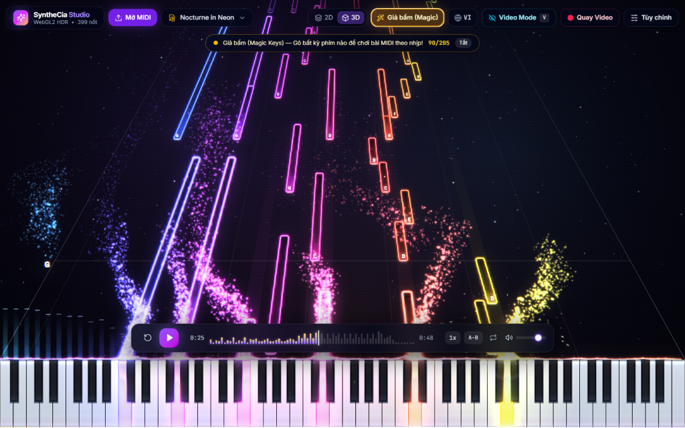

# SyntheCia Studio

> **Luminous WebGL2 MIDI Piano Visualizer** — AAA 3-Octave Optical HDR Bloom, GPU Physics Particles, 3D Rainbow Neon Highway, Magic Keys Perform Mode, USB Web MIDI & Clean 60fps Video Recorder.



[](https://synthecia-studio.vercel.app)
[](LICENSE)
[](https://www.typescriptlang.org/)
[](#architecture)
[](https://vitejs.dev/)

---

## Highlights

- **AAA 3-Octave Optical HDR Bloom + 2x SSAA & FXAA**: Multi-pass Dual-Kawase bloom with 4-tap anti-flicker prefiltering, 2x supersampling, and FXAA edge smoothing — silky-smooth diagonal 3D neon lines with zero stair-stepping.
- **24,000+ GPU Physics Particles & 4 Particle Themes**:
  - **Cosmic**: Curl-noise fluid silk plumes, velocity-stretched bouncing comet sparks & 4-point optical star glints
  - **Volcanic Fire**: Blackbody temperature-cooling embers & rising flames
  - **Sakura Petals**: Spinning glowing cherry blossom petals drifting on a breeze
  - **Glacier Frost**: Rotating 6-point ice crystal snowflakes
- **Concert Stage Visuals**:
  - **2D Classic** & **3D Perspective Highway** with **Dynamic 3D Camera Drift**, multi-tempo measure bars & real-time chord detection (`Cmaj7`, `F#`, `B7`…)
  - **3D Velocity-Scaled Piano Key Depression** with adjacent side-shadows, crimson keybed felt, **Smooth Liquid Plasma Edge** & optional **Harmonic Bezier Chord Arcs**
  - **Live Audio EQ Spectrum**, **Glossy Piano Keybed Mirror Reflection**, **Anamorphic Horizontal Strike Flares**, and **Sustain Pedal (CC64) Resonance Aura**
  - **Luminous On-Canvas Lyrics (`.lrc` / `.srt`)** rendered directly into the WebGL2 canvas (included in Clean Mode & 60fps video exports!)
- **Audio → MIDI Pro Transcriber (Web Worker + HPSS Drum Filter)**:
  - Drop or upload any normal song (`.mp3`, `.wav`, `.ogg`, `.flac`, `.m4a`) to auto-transcribe polyphonic falling piano notes off-thread with **HPSS drum/percussion filtering**, smart dynamic Left/Right hand split, instant **Re-Transcribe**, original-audio sync, and standard `.mid` export!
- **Custom Image & Video / Overhead Real-Hands Overlay (`.mp4 / .webm`)**:
  - Use looping videos or cached-blur images as backdrops, **OR** overlay your own **overhead piano footage of real hands** with Y-alignment, Zoom, Top Feather Mask, MIDI sync offset (`±3000ms`), and optional synthetic keyboard hide — Rousseau / SeeMusic Pro style right in the browser!
- **Cinematic Title Intro Card & Channel Watermark**: Baked directly into the WebGL2 canvas so OBS & exported 60fps videos come ready for YouTube/TikTok.
- **4 Interactive Performance & Practice Modes + Rhythm Combo HUD**:
  - **Magic Keys ("Giả bấm") with Adaptive Rubato Glide**: Load any MIDI (or transcribed audio) and tap **any** key on your keyboard — every tap performs the exact next chord with tempo-adaptive silky flow, configurable smoothness, and humanized chord micro-strum!
  - **Wait-for-Note Practice Mode**: Pauses automatically at each chord until you play the glowing amber keys on USB MIDI, QWERTY, or screen — choose **Both Hands**, **Right Hand Only**, or **Left Hand Only** (with backing hand auto-played!).
  - **QWERTY Live Piano**: Play 2+ octaves right on your computer keyboard (`Z–M` & `Q–P`, `[ / ]` octave shift, `Shift` sustain pedal).
  - **Web MIDI API (USB Piano)** + optional **Rhythm Accuracy & Combo HUD** (`PERFECT / GREAT / GOOD`).
- **5 Studio Instruments, Transpose & Metronome**:
  - Switch live between **Concert Grand (Salamander)**, **Warm Felt Piano**, **Electric Rhodes EP**, **Music Box / Celesta**, and **Grand + Orchestral Strings Pad**, plus real-time **Transpose (`±12 st`)**, **Studio Metronome**, **Custom Sync Audio (`.mp3` / `.wav`)**, per-track **Mute/Hide/Color/Hand**, and **A-B Loop**.
- **Clean Video Mode & Direct 60fps Video Exporter**:
  - Press `V` for 100% zero-UI, cursor-hidden capture (OBS-ready) with `Full`, `16:9`, `9:16 TikTok/Shorts`, and `1:1` framing
  - Press `R` to record & download 60fps WebM/MP4 video with synced stereo audio directly from the WebGL2 canvas
- **Multi-Song Library, Shareable Preset Links & Installable PWA**: Bilingual **English / Tiếng Việt** UI, auto-saved settings (`localStorage`), multi-song **Saved Library** & backdrop cache (`IndexedDB`), **1-click Shareable Preset URL (`#preset=...`)**, **JSON Preset Export/Import**, and installable desktop/mobile PWA support.

---

## Quick Start

```bash
# 1. Install dependencies
npm install

# 2. Start local dev server (http://localhost:5173)
npm run dev

# 3. Run tests & production build
npm test
npm run build
```

> **Tip:** Drag and drop any `.mid` song, backdrop image (`.png`/`.jpg`/`.webp`), sync audio (`.mp3`/`.wav`), or `.json` preset file directly onto the window!

---

## Keyboard Shortcuts

| Key | Action |
| --- | --- |
| `Space` | Play / Pause (Auto Play mode) |
| `V` | Toggle **Clean Video Mode** (hide all UI + auto-hide cursor) |
| `R` | Start / Stop **Direct 60fps Video Recording** |
| `←` / `→` | Seek backward / forward 5 seconds |
| `Esc` | Exit Clean Video Mode / Stop Recording / Close Drawer |
| `Any Letter / Digit` | Fire next MIDI chord in **Magic Keys** mode |
| `Z–M`, `Q–P`, `[ / ]`, `Shift` | Live 2-octave keys, octave shift & sustain in **QWERTY Piano** mode |

---

## Architecture

SyntheCia Studio uses a **Hybrid Canvas 2D Scene + WebGL2 GPU Post-Processing** pipeline:

1. **`SceneRenderer`** (`src/engine/SceneRenderer.ts`): Renders cached blurred backdrops, `O(log N)` windowed 2D/3D falling notes, live EQ spectrum, mirror keybed reflections, plasma waves, and an 88-key piano onto a HiDPI scene buffer.
2. **`WebGLCompositor`** (`src/engine/WebGLCompositor.ts`): Uploads the scene to GPU, simulates & renders 24,000+ additive physics particles (`PARTICLE_VS`/`FS`), and executes a 3-octave Dual-Kawase HDR Bloom + ACES filmic clarity composite into a single master canvas — enabling one-stream `canvas.captureStream(60)` recording.
3. **`AudioEngine`** (`src/audio/AudioEngine.ts`): Unified Web Audio graph with Salamander Grand Piano samples, procedural concert-hall convolution reverb, offline synth fallback, custom audio sync, FFT analyser, and `MediaStreamAudioDestinationNode`.

---

## Deploying to Vercel

SyntheCia Studio is pre-configured for zero-config deployment via [`vercel.json`](vercel.json):

1. Import your GitHub repository on [vercel.com/new](https://vercel.com/new), or deploy from your terminal with `vercel`.
2. Vercel auto-detects **Vite** (`npm run build` → `dist`) and publishes your live HTTPS visualizer in seconds.

A GitHub Actions CI workflow at [`.github/workflows/ci.yml`](.github/workflows/ci.yml) automatically runs `npm test` and `npm run build` on every push and pull request.

---

## License

Released under the [MIT License](LICENSE).
